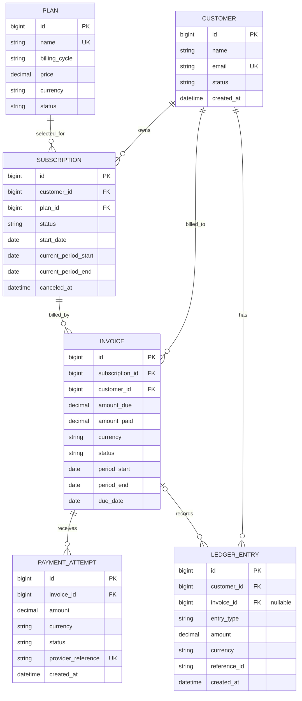

# SubLedger Low-Level Design

## Scope

This document describes the current implementation in the Django REST Framework project. It covers the data model, API boundary, service and repository responsibilities, business-rule ownership, and invoice/payment workflows. `*Schema` classes are DRF serializers: they validate and serialize API data; they are not database schemas.

## Architecture

```text
HTTP request
  -> URL router / ViewSet
  -> DRF serializer validation
  -> Service (business rules and transaction orchestration)
  -> Repository (Django ORM reads and writes)
  -> Django model / database constraints
  -> serialized HTTP response
```

Services coordinate behavior across domains. Repositories encapsulate ORM operations. Model/database constraints provide integrity protection even when a write bypasses the normal API path. Customer and plan services currently delegate directly to their repositories; the more involved workflows are in subscription, invoice, and payment services.

## Entity Relationship Diagram



Every subscription references one customer and one plan. Every invoice references one subscription and one customer. Every payment attempt references one invoice. A ledger entry references one customer and may reference an invoice; the nullable invoice FK allows customer-level entries that are not tied to an invoice. `PROTECT` is used on these foreign keys so referenced billing records cannot be deleted through normal ORM deletion.

## API Surface

| Resource | Endpoints | Behavior |
| --- | --- | --- |
| Plans | `GET/POST /api/plans/`, `GET/PUT/PATCH/DELETE /api/plans/{id}/` | CRUD |
| Customers | `GET/POST /api/customers/`, `GET/PUT/PATCH/DELETE /api/customers/{id}/` | CRUD |
| Subscriptions | `GET/POST /api/subscriptions/`, `GET /api/subscriptions/{id}/`, `POST /api/subscriptions/{id}/cancel/` | Create, inspect, cancel; no general update/delete endpoint |
| Invoices | `GET /api/invoices/`, `GET /api/invoices/{id}/`, `POST /api/invoices/generate/` | Read and generate; no general update/delete endpoint |
| Payment attempts | `GET /api/payments/`, `GET /api/payments/{id}/`, `POST /api/payments/` | Read and record attempts |
| Ledger entries | `GET /api/ledger/`, `GET /api/ledger/{id}/` | Read-only |
| API schema/docs | `GET /api/schema/`, `GET /api/docs/` | OpenAPI schema and Swagger UI |

When `DEBUG` is enabled, the configured permission class allows anonymous API requests. Outside debug mode, Basic or Session authentication is required.

## Service Responsibilities

| Service | Owns | Should not own |
| --- | --- | --- |
| `CustomerService` | Customer create/update/delete orchestration; delegates to `CustomerRepository` | Email request validation or ORM query construction |
| `PlanService` | Plan create/update/delete orchestration; delegates to `PlanRepository` | API field validation or ORM query construction |
| `SubscriptionService` | Active customer/plan eligibility, billing-period calculation, subscription creation, cancellation | HTTP response formatting or direct query construction |
| `InvoiceService` | Active-subscription check, invoice period/defaults/status/amount, duplicate protection, charge-ledger orchestration, invoice balance/status transition | Request parsing or standalone payment-attempt persistence |
| `PaymentService` | Invoice acceptance checks, currency match, successful/failed payment behavior, atomic coordination of invoice/attempt/ledger writes | HTTP response formatting or ledger query construction |
| `LedgerService` | Read-only listing and translating invoice creation into an append-only charge entry through `LedgerRepository` | Updating/deleting ledger entries or invoice lifecycle decisions |

## Repository Responsibilities

| Repository | Entities read | Entities written | Common methods |
| --- | --- | --- | --- |
| `CustomerRepository` | Customer | Customer | `list`, `get`, `exists`, `create`, `update`, `delete` |
| `PlanRepository` | Plan | Plan | `list`, `get`, `exists`, `create`, `update`, `delete` |
| `SubscriptionRepository` | Subscription, Customer, Plan | Subscription | `list`, `get`, `get_for_invoice`, `exists`, `get_customer`, `get_plan`, `create`, `save` |
| `InvoiceRepository` | Invoice, Subscription | Invoice | `list`, `get`, `get_for_update`, `exists`, `get_subscription_for_update`, `find_for_period`, `create`, `save` |
| `PaymentRepository` | PaymentAttempt, Invoice | PaymentAttempt | `list`, `create`, `invoice_for_update` |
| `LedgerRepository` | LedgerEntry | LedgerEntry (append only) | `list`, `create_entry` |

Repositories contain ORM access, including `select_related` for related-object reads and `select_for_update` for records that must be locked in transactional workflows. They do not decide billing policy.

## Business Rule Ownership

| Rule | Primary enforcement | Additional integrity protection |
| --- | --- | --- |
| Customer email is trimmed/lowercased and unique regardless of case | `CustomerSchema.validate_email` | Case-insensitive unique constraint on `Lower(email)` |
| Plan names are unique; plan price must be greater than zero | `PlanSchema` requires at least `0.01` | Unique name and positive-price DB constraint |
| Custom plans require a description | `PlanSchema.validate` | `Plan.clean` contains the same check; note that Django does not call `clean()` automatically on `save()` or `objects.create()` |
| Currency is stored uppercase where normalized | Plan/payment serializers; ledger model `save()` | No general database uppercase constraint |
| Subscription requires existing customer and plan IDs | `SubscriptionCreateSchema` | Foreign keys |
| Only active customers can subscribe, and only to active plans | `SubscriptionService.create` | No matching DB constraint |
| Custom billing cycles require explicit period end; standard cycles infer one, clamping month-end dates to the last valid day | `SubscriptionService.create` | Positive subscription-period check in the DB |
| At most one active subscription exists for a customer/plan pair | `SubscriptionService.create` handles the user-facing conflict | Conditional unique constraint on active rows |
| Canceling a subscription is idempotent and sets `canceled_at` when canceled | `SubscriptionService.cancel` | — |
| An invoice can be generated only for an existing active subscription; amount/currency come from its related plan | `InvoiceService.generate` loads the subscription and handles not-found/ inactive cases | Subscription/plan foreign keys |
| Invoice period defaults to the current subscription period; generated invoices start as `issued` | `InvoiceService.generate` | Positive invoice-period check in the DB |
| One invoice per subscription and billing period | `InvoiceService.generate` pre-check and conflict handling | Unique constraint on subscription and period dates |
| An invoice-created event is recorded as a `charge` ledger entry | `LedgerService.record_invoice_created`, called by `InvoiceService.generate` | Same database transaction as invoice creation |
| Every ledger entry has a non-empty trace reference; invoice charges and successful payments use namespaced IDs | `LedgerService.record_invoice_created` and `PaymentService.record` populate references | Required-field validation plus `ledger_reference_id_required` database check |
| Payment amount must be positive; provider reference must be unique when supplied | `PaymentCreateSchema` | Positive-amount check and unique field constraint |
| Payment currency must match invoice currency; draft, void, and paid invoices reject payment | `PaymentService.record` | No corresponding cross-row DB constraint |
| Successful payment cannot exceed remaining invoice balance; it updates amount/status | `InvoiceService.update_payment_state`, called by `PaymentService` | Invoice checks for nonnegative amounts and paid amount not exceeding due amount |
| Failed attempts do not change invoice balance or create payment ledger entries | `PaymentService.record` | Service transaction behavior |
| Successful attempts create a payment ledger entry | `PaymentService.record` | Same database transaction as invoice update and attempt creation |
| Ledger entries have positive amounts and cannot be changed/deleted through the model/queryset API | `LedgerEntry` checks, `save`, `delete`, and custom queryset | Positive-amount DB check; immutability itself is ORM-level, not a DB trigger |
| Billing records cannot delete referenced customers, plans, subscriptions, or invoices | Foreign-key `on_delete=PROTECT`; viewsets translate protected deletes to API validation errors where applicable | Database foreign keys |

## Design Patterns

**Service Layer Pattern:** domain operations are exposed through service methods. `SubscriptionService`, `InvoiceService`, and `PaymentService` own business decisions and transaction boundaries, keeping views focused on request/response handling. This is especially useful for payment recording, which must update several records as one operation.

**Repository Pattern:** each domain repository centralizes Django ORM queries and writes for its model. Services depend on repository methods rather than building ORM queries themselves. Repositories currently remain intentionally small and do not implement a separate unit-of-work abstraction.

## Invoice Generation Flow

1. `POST /api/invoices/generate/` validates `subscription_id`, `due_date`, and optional period dates with `InvoiceGenerateSchema`. Period start and end must be supplied together and end must be later than start; the schema validates shape, while the service validates subscription existence.
2. `InvoiceService.generate` begins an atomic transaction and loads/locks the subscription with its customer and plan.
3. Return a validation error if the subscription does not exist or is not active. Use the requested period or default to the subscription's current period. Reject if that subscription already has an invoice for the period.
4. Create an `issued` invoice for the related plan's price and currency, copy the subscription's customer, and set `amount_paid` to zero. A draft-selection rule is not currently exposed by the API.
5. Call `LedgerService.record_invoice_created`, which writes a `charge` ledger entry referencing the customer and invoice.
6. Commit both writes together and return the serialized invoice. Any failure rolls back both writes.

## Payment Recording Flow

1. `POST /api/payments/` validates the invoice ID, positive amount, currency, status, and optional provider reference with `PaymentCreateSchema`.
2. `PaymentService.record` begins an atomic transaction and locks the invoice row.
3. Reject a currency mismatch or an invoice in `paid`, `void`, or `draft` status.
4. For a `success` attempt, call `InvoiceService.update_payment_state`. Reject an overpayment; otherwise update `amount_paid` and set status to `paid`, `partially_paid`, `overdue`, or `issued` as appropriate.
5. Create the payment attempt. A failed attempt skips the invoice update.
6. For a successful attempt, append a `payment` ledger entry. Commit the invoice update, attempt, and ledger entry together. Failed attempts commit only the attempt.

## Integrity Notes and Boundaries

- Invoice generation sets `invoice.customer` from `invoice.subscription.customer`, but the database does not enforce that equality for rows written outside this service.
- Ledger creation sets its customer from the invoice in billing workflows, but the database does not enforce `ledger_entry.customer_id == ledger_entry.invoice.customer_id` when an invoice is present.
- Payment currency matching is enforced in the service, not by a database constraint.
- Ledger `reference_id` cannot be empty, and invoice/payment flows use `invoice:<id>` and `payment_attempt:<id>` identifiers. The reference is not globally unique because different ledger events may legitimately share an external grouping reference.
- Ledger immutability is enforced by Django model/queryset methods; direct SQL or other database clients can bypass those application-level guards.
- `select_for_update` provides row-lock protection on databases that support it (such as PostgreSQL). SQLite-based local/test runs do not provide equivalent row-level locking.
- Model/database constraints are the final protection for uniqueness and row-local value invariants; request serializer validation provides clearer API errors but can be bypassed by direct ORM writes.

## Tests

The app test modules cover API behavior and business rules across the system:

- `customers/tests.py`: email normalization, list/detail/update behavior, and protected deletion.
- `plans/tests.py`: create/list/retrieve/update, currency normalization, positive-price API/database constraints, custom-cycle validation, and protected deletion.
- `subscriptions/tests.py`: month-end period calculation, active customer/plan requirements, duplicate active subscriptions, list/retrieve, and idempotent cancellation.
- `invoices/tests.py`: invoice generation, issued status, amount snapshot, charge-ledger creation, list/retrieve, invalid periods, missing/inactive subscriptions, duplicate invoices, and read-only routes.
- `payments/tests.py`: partial/full/failed payments, overpayment, currency mismatch, duplicate provider references, payment reads, invoice/subscription conflicts, ledger consistency, and end-to-end API flow.
- `ledger/tests.py`: list/retrieve, read-only API behavior, and rejection of empty trace references.

Run the complete suite with `python manage.py test customers.tests plans.tests subscriptions.tests invoices.tests payments.tests ledger.tests`.
